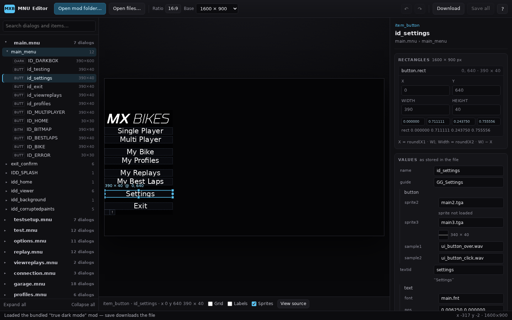

# MX Bikes UI mods & editor

Two UI mods for MX Bikes, plus a browser-based editor for their menu scripts.

| Path | Purpose |
| --- | --- |
| `mesx5 ui/` | **MESX5 UI** — the Monster Energy Supercross 5 style overhaul |
| `true dark mode/` | The original *Dark UI* mod it is built from |
| `index.html`, `assets/` | The MNU editor — plain HTML/CSS/JS, no build step |
| `tools/` | Scripts that generate the MESX5 artwork, palette and main-menu layout |
| `tests/` | Node checks for the parser/serializer, the TGA decoder and the overhaul |



## MESX5 UI

`mesx5 ui/` is an overlay for the game's `data/ui` folder: copy the files you
want over the base ones, keeping the same names. Anything a mod folder leaves
out keeps the base game's art, so this mod only ships the chrome it restyles.

The look follows Monster Energy Supercross – The Official Videogame 5: deep navy
panels, a royal-blue selected state, neon-green frames and accents, a magenta
exit chip and white labels. It is applied everywhere, not only to the hub:

- **Every dialog** — new panel art with a header band, blue hairline border and
  a new label ramp (white / ice / steel-blue) across all 15 menus.
- **Every control** — buttons, tabs, checkboxes, radio buttons, switches,
  sliders, scrollbars, spinners, sort arrows, list rows and replay transport
  icons are redrawn in the new palette, in all three sprite states.
- **Main menu** — rebuilt as the MESX5 hub: an exit chip and the MX Bikes
  wordmark in a header band, a `Multi Player` hero tile, and a grid of tiles
  for `Single Player`, `My Bike`, `My Profiles`, `My Best Laps`, `My Replays`
  and `Settings`. The `!` and home shortcuts from the original menu are still
  there, small, in the bottom-left corner.
- **Wallpapers** — the Dark UI photography re-graded to a dark blue stadium
  treatment for `bkgrnd.tga` (menus) and `splash.tga` (boot).
- **Tooltip and guide** colours from `ui.ui`.

### What is *not* changed

Only presentation is different. For every file, the dialogs, item order, item
names, text ids, `guide` bindings, sounds, list columns and structure are
identical to the Dark UI mod — `tests/mesx5.test.js` compares both mods item by
item and fails on any difference outside `rect`, sprites, colours, text
position/size/alignment and similar layout-only keys. Nothing was added to or
removed from a menu, so every control the game binds still exists. Labels and
menu wording are untouched (`english.str` is unchanged).

The mod is verified with the editor, which approximates the game's renderer:
sprites, rects, colours and text are checked, but the actual game is the final
judge of font metrics. The MESX5 tiles rely on labels being drawn from the
item's top-left corner, which is how the editor and the original 40 px-tall
buttons both read the format; if the game centres text inside tall tiles the
labels will sit slightly lower than in the preview.

### Regenerating the artwork

```sh
node tools/mesx5-art.js       # rewrite the whole TGA chrome set into "mesx5 ui"
node tools/mesx5-colors.js "mesx5 ui" --write   # re-apply the palette to .mnu files
node tools/mesx5-layout.js    # re-apply the main-menu tile grid
```

`mesx5-art.js` draws every sprite procedurally (no image editing), so the art
is reproducible and diffable; the wallpapers are graded from `true dark mode/`.
Files use the same TGA shapes as the Dark UI mod, which is what the game loads:
chrome is uncompressed 32-bit, the two wallpapers are RLE 24-bit at the original
3840 × 2160, and RLE packets never cross a scanline (`tests/mesx5.test.js`
rejects any generated sprite that does, because strict loaders do; artwork
copied unchanged from the Dark UI mod keeps its original bytes).
`mesx5-colors.js` only rewrites the four numbers on colour lines — greys are
mapped onto the ink/ice ramp by luminance, saturated colours onto the
blue/green/magenta accents. `mesx5-layout.js` rewrites only rect, sprite and
text-size values of the named main-menu items, through the editor's parser.

## The editor

Open `index.html` in Chrome, Edge or another Chromium browser:

- **Served from this repo** (GitHub Pages, `python3 -m http.server`, …) it loads
  the mod chosen in the **Mod** dropdown (MESX5 UI by default) for a quick look.
  Saving downloads the file.
- **Open mod folder…** gives the editor write access, so *Save* writes straight into the
  folder. Pick the folder that contains `ui.ui` and the `.mnu` files.
- **Open files…** (or dropping files onto the page) loads individual `.mnu` / `.ui` /
  `.str` / `.tga` files. Saving downloads the file.

### What you can do

- Browse every file, dialog and item in the tree, with a search filter.
- See a dialog rendered at the UI's aspect ratio with the mod's own sprites, text,
  colours and slider/list/checkbox structure drawn in roughly the right places.
- Drag an item to move it, drag a handle to resize it, or type exact pixel values.
  Arrow keys nudge 1 px, Shift + arrows 10 px.
- Edit every other value in the file — names, text ids, sprites, colours, fonts,
  sizes, flags, list columns, spin buttons — in the *Values* card. `align` is a
  dropdown (`left` / `center` / `right`); right-aligned text is inset from the
  item's right edge, so button labels stay inside the button.
- Undo/redo (`Ctrl/⌘+Z`, `Ctrl/⌘+Shift+Z`), view the file source, and save.

### Rectangles

Rect values are floats from 0 to 1 of the UI surface. `ui.ui` sets the aspect ratio
(this mod: `ratio 16:9`), and the base resolution chosen in the toolbar supplies W and H.
With 1600 × 900:

```
X      = round(X1 * W)
Y      = round(Y1 * H)
Width  = round(X2 * W) - X
Height = round(Y2 * H) - Y
```

The pixel fields apply this in both directions, so typing `390` for *Width* writes
`0.243750` and leaves the file's float precision intact. A file that is parsed and saved
without edits is byte-for-byte identical to the original; edited files change only the
lines you touched.

The preview is an approximation of the game: sprites are decoded from the mod's TGA
files, text is drawn with a system font at the size stored in the file (the game uses
`main.fnt`), and runtime values/animations are not simulated. Buttons preview their
normal state (`sprite2`).

### Looking at the art

```sh
node tools/tga-png.js "mesx5 ui" artifacts/png   # every sprite as a PNG
```

Sprites are drawn on transparency, so a PNG viewer may show them on white.

## Tests

No dependencies:

```
node tests/mnu-format.test.js
node tests/tga.test.js
node tests/mesx5.test.js
```

`mnu-format.test.js` round-trips all 15 Dark UI menus and fails on a single differing byte.
`tga.test.js` compares decoded pixels against independently generated reference values.
`mesx5.test.js` round-trips the MESX5 menus, checks the overhaul against the Dark UI
mod item by item, decodes every shipped sprite and checks the main-menu tiles do not
overlap.
