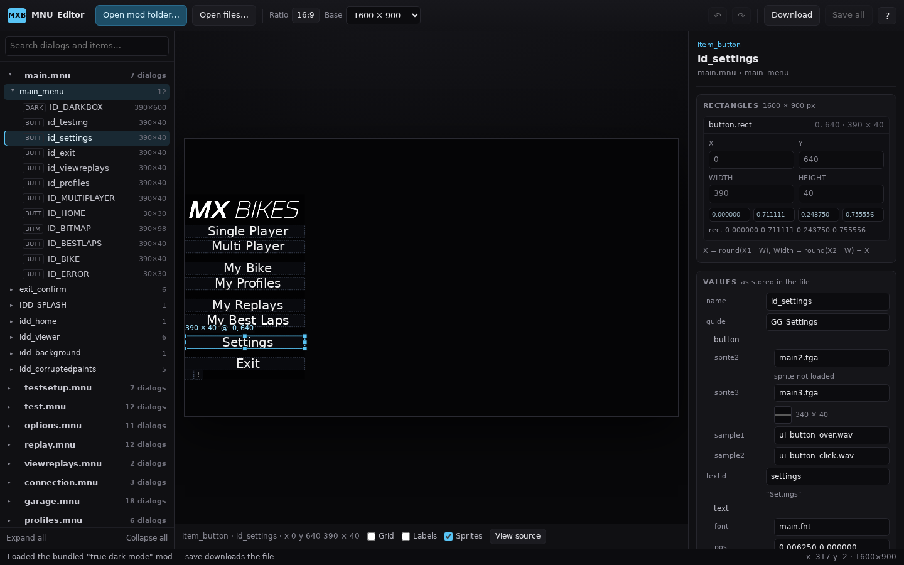

# MX Bikes — True Dark Mode UI

Files for the *True Dark Mode* UI mod for MX Bikes, plus a browser-based editor for the
`.mnu` dialog scripts.

| Path | Purpose |
| --- | --- |
| `true dark mode/` | The mod: `ui.ui`, 15 `.mnu` menus, `english.str`, TGA sprites |
| `index.html`, `assets/` | The MNU editor — plain HTML/CSS/JS, no build step |
| `tests/` | Node checks for the `.mnu` parser/serializer and the TGA decoder |



## The editor

Open `index.html` in Chrome, Edge or another Chromium browser:

- **Served from this repo** (GitHub Pages, `python3 -m http.server`, …) it loads
  `true dark mode/` automatically for a quick look. Saving downloads the file.
- **Open mod folder…** gives the editor write access, so *Save* writes straight into the
  folder. Pick the folder that contains `ui.ui` and the `.mnu` files.
- **Open files…** (or dropping files onto the page) loads individual `.mnu` / `.ui` /
  `.str` / `.tga` files. Saving downloads the file.

### What you can do

- Browse every file, dialog and item in the tree, with a search filter.
- See a dialog rendered at the UI's aspect ratio with the mod's own sprites, text,
  colours and slider/list/checkbox structure drawn in roughly the right places.
- Drag an item to move it, drag a handle to resize it, or type exact pixel values.
  Arrow keys nudge 1 px, Shift + arrows 10 px.
- Edit every other value in the file — names, text ids, sprites, colours, fonts,
  sizes, flags, list columns, spin buttons — in the *Values* card. `align` is a
  dropdown (`left` / `center` / `right`); right-aligned text is inset from the
  item's right edge, so button labels stay inside the button.
- Undo/redo (`Ctrl/⌘+Z`, `Ctrl/⌘+Shift+Z`), view the file source, and save.

### Rectangles

Rect values are floats from 0 to 1 of the UI surface. `ui.ui` sets the aspect ratio
(this mod: `ratio 16:9`), and the base resolution chosen in the toolbar supplies W and H.
With 1600 × 900:

```
X      = round(X1 * W)
Y      = round(Y1 * H)
Width  = round(X2 * W) - X
Height = round(Y2 * H) - Y
```

The pixel fields apply this in both directions, so typing `390` for *Width* writes
`0.243750` and leaves the file's float precision intact. A file that is parsed and saved
without edits is byte-for-byte identical to the original; edited files change only the
lines you touched.

The preview is an approximation of the game: sprites are decoded from the mod's TGA
files, text is drawn with a system font at the size stored in the file (the game uses
`main.fnt`), and runtime values/animations are not simulated. One sprite is missing from
the folder — `main2.tga`, the normal button state — so buttons preview with their hover
artwork (`main3.tga`).

## Tests

The parser, rect maths and TGA decoder are checked without any dependencies:

```
node tests/mnu-format.test.js
node tests/tga.test.js
```

`mnu-format.test.js` round-trips all 15 menus and fails on a single differing byte.
`tga.test.js` compares decoded pixels against independently generated reference values.
